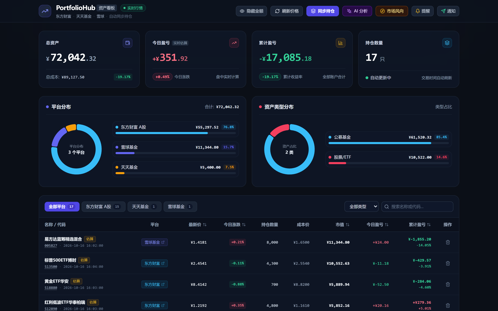
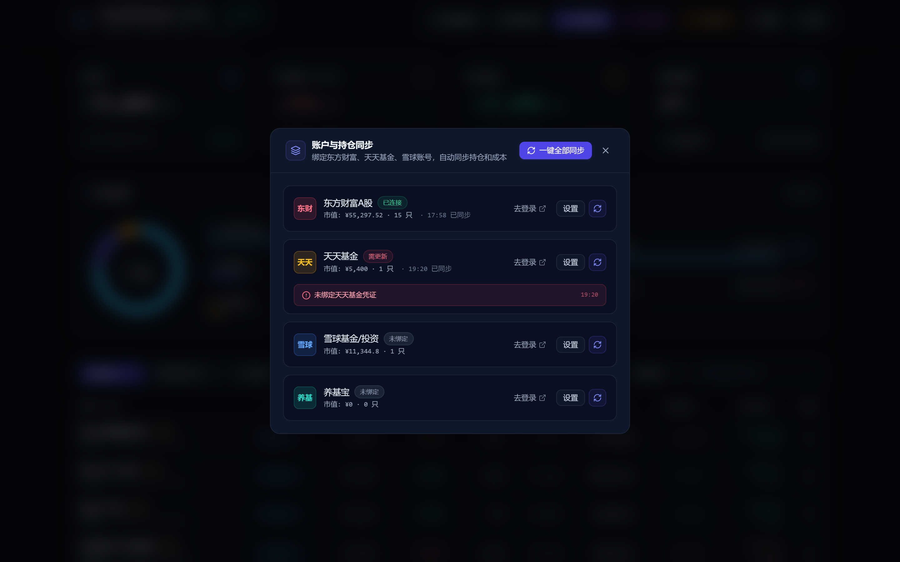
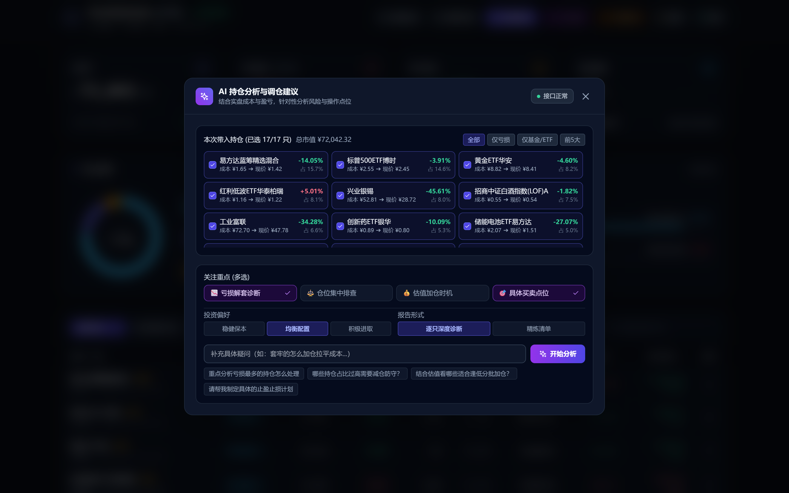
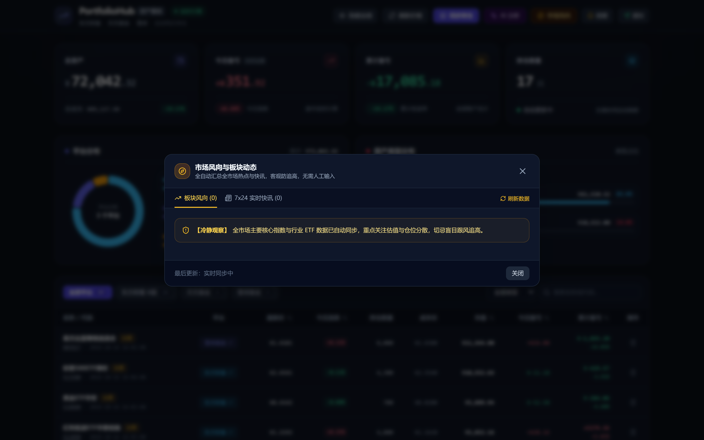
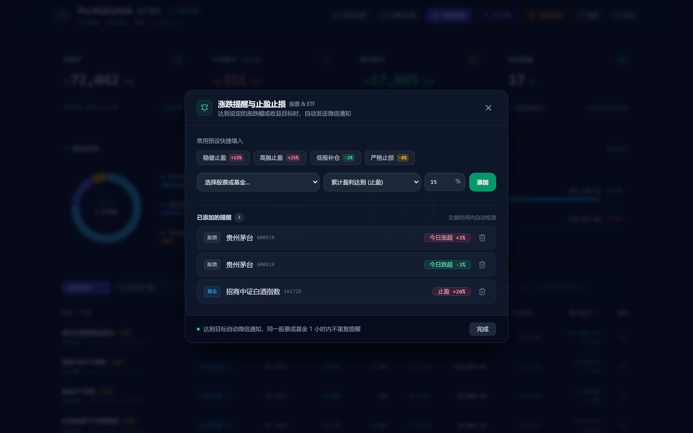

# PortfolioHub 资产看板 📈

> **个人多账户股票与基金看板**。自动同步 **东方财富**、**天天基金**、**雪球**、**养基宝** 的持仓与买入成本，实时查看今日盈亏和总收益，支持微信涨跌提醒与 AI 持仓建议。

---

## 🖼️ 界面预览

### 1. 资产看板全貌
统一汇总所有平台的股票、ETF 与公募基金，一眼看清总资产、今日盈亏与持仓占比。


### 2. 自动同步持仓
支持东方财富、雪球基金、天天基金、养基宝多账号绑定，一键即可同步最新持仓和买入成本，无需手动输入。


### 3. AI 持仓体检与建议
结合实际买入成本与浮盈浮亏，客观分析持仓结构与风险，给出通俗直白的操作参考。


### 4. 市场风向与热点动态
自动汇总全市场热点板块动态与 7x24 实时快讯，辅助把握行情节奏，理性防追高。


### 5. 涨跌提醒与止盈设置
自由设定个股或基金的日涨跌幅度与目标收益率，触发后自动推送到个人微信。


---

## ✨ 核心功能

- **多平台自动同步**：
  - **东方财富**：自动同步实盘股票、ETF 持仓数量与成本价。
  - **天天基金**：自动同步场外基金份额与买入成本，交易时间内支持盘中实时估算。
  - **雪球**：自动同步雪球组合持仓与自选基金。
  - **养基宝**：支持直接粘贴持仓 JSON 文本或配置 API Token，自动汇总基金份额与持仓成本。
- **实时价格与盈亏**：
  - 股票与 ETF 秒级行情刷新。
  - 盘中实时估算基金浮动盈亏，收盘后自动同步基金公布净值。
- **微信自动通知**：
  - 支持绑定 PushPlus 微信推送。
  - 每个交易日定时推送：**09:25 开盘提醒**、**15:05 收盘日报**、**21:45 基金净值更新**。
  - 持仓达到设定的目标涨跌幅或止盈止损线时实时发送提醒。
- **AI 智能分析**：
  - 支持自定义分析重点（回本策略、仓位风险、估值性价比、买卖点位）与投资风格。
- **隐私脱敏模式**：
  - 支持一键隐藏/显示资金金额，在公共场合使用更安心。

---

## 🚀 快速启动

### 方式一：一键启动（推荐）
直接双击运行根目录下的 **`start.bat`** 即可自动启动后端与前端，并在浏览器中打开：
```
http://127.0.0.1:8000
```

### 方式二：命令行手动启动

1. **后端启动**：
   ```bash
   cd backend
   python main.py
   ```

2. **前端启动（开发调试模式）**：
   ```bash
   cd frontend
   npm run dev
   ```

---

## 🧭 Code Review Graph 代码知识图谱

本项目已完整集成并接入 **`code-review-graph`**。它通过 Tree-sitter 对全项目代码（Python + Vue + JS）进行语法结构解析，自动构建全局代码知识图谱，用于架构理解、变更影响分析与高质量代码审查。

### 1. 当前图谱状态
项目已建立图谱索引数据库，包含：
- **节点数量**：181 个（包含类、函数、文件与测试节点）
- **关系边数**：1485 条（覆盖调用关系、继承关系、导入链路与数据引用）
- **涵盖语言**：Python、Vue 3、JavaScript

### 2. 常用操作指令

可以在 `frontend` 目录或项目根目录下直接使用以下指令管理代码图谱：

```bash
# 查看当前图谱统计信息
npm run graph:status
# 或直接执行：python -m code_review_graph status

# 在代码变更后更新图谱
npm run graph:build
# 或增量更新：python -m code_review_graph update

# 生成可交互的代码依赖可视化网页
npm run graph:visualize
# 生成的 HTML 文件位于 .code-review-graph/graph.html，可直接在浏览器中打开全景缩放漫游
```

### 3. 配置 MCP 服务（支持 Claude / Cursor / Antigravity）

若需要在 AI 辅助编程工具中调用图谱审查能力，可在 MCP 配置文件（如 `mcp_config.json` 或 `.mcp.json`）中添加：

```json
{
  "mcpServers": {
    "code-review-graph": {
      "command": "python",
      "args": ["-m", "code_review_graph", "serve"],
      "cwd": "d:/fork/gupiao"
    }
  }
}
```

配置后，AI 即可在做代码重构或审查时，自动调用 `get_impact_radius_tool`、`detect_changes_tool` 等工具秒级评估改动影响范围。

---

## 🧪 自动化测试

项目已配置完整的 Playwright 端到端（E2E）全链路回归测试套件，全面覆盖 7 项后端接口状态码、页面组件挂载、弹窗交互、过滤搜索与无死角控制台报错监测：

```bash
cd frontend
npm run test:e2e
```

---

## 🔑 账户绑定指引

点击主看板右上角 **【同步持仓】** 即可绑定账号，操作直白：

### 1. 东方财富
1. 打开浏览器登录东方财富网上交易端 (`jywg.18.cn`)。
2. 按 `F12` 打开开发者工具，切到【网络 (Network)】标签。
3. 点击左侧【资金持仓】，在请求列表中复制请求标头的 `Cookie` 粘贴并保存。

### 2. 雪球
1. 打开 [雪球网](https://xueqiu.com) 并登录账号。
2. 按 `F12` 打开控制台，在【同步持仓】弹窗中点击【复制提取代码】并在控制台粘贴回车。
3. 将返回的内容粘贴到输入框中保存。

### 3. 天天基金
1. 浏览器打开天天基金交易页面 (`tradeh5.1234567.com.cn`) 登录。
2. 在【同步持仓】弹窗中点击【复制提取代码】并在控制台粘贴回车获取 Cookie。
3. 粘贴到输入框中保存即可自动拉取基金持仓。

### 4. 养基宝
1. 打开养基宝小程序或 APP，导出个人基金持仓明细（支持标准 JSON 格式）。
2. 在【同步持仓】的养基宝配置卡片中，直接将持仓 JSON 文本粘贴到输入框中。
3. 也支持配置 `接口URL | Bearer Token` 模式。
4. 点击【保存并同步】，系统将秒级解析每只基金的代码、份额与买入成本。

---

## 📂 项目结构

```
gupiao/
├── backend/                        # 后端服务 (FastAPI + SQLite)
│   ├── app/
│   │   ├── api/endpoints.py        # 资产统计、账户同步、提醒规则 API
│   │   ├── services/
│   │   │   ├── quote_service.py    # 股票与基金实时行情获取
│   │   │   ├── auto_sync_engine.py # 东财/天天/雪球多平台同步引擎
│   │   │   ├── portfolio_service.py# 资产计算与快照统计
│   │   │   ├── notify_service.py   # 微信通知推送
│   │   │   └── scheduler_service.py# 每日定时开盘/收盘日报任务
│   │   └── main.py                 # FastAPI 服务启动入口
├── frontend/                       # 前端界面 (Vue 3 + TailwindCSS + ECharts)
│   ├── src/
│   │   ├── components/             # 资产卡片、持仓表格、各类弹窗
│   │   └── App.vue                 # 页面主框架
│   ├── e2e_regression.cjs          # E2E 自动化回归测试脚本
│   └── dist/                       # 前端生产打包产物
├── docs/
│   └── images/                     # 系统高清功能截图
├── GEMINI.md                       # 文案规范与设计原则（通俗易懂、拒黑话）
├── start.bat                       # Windows 一键启动脚本
└── run_dev.bat                     # 前端热重载开发启动脚本
```
